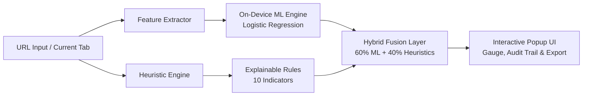

# PhishGuard: Local Hybrid Phishing Scanner (v1.1.0)

A privacy-first, client-side Chrome / Edge extension that evaluates active URLs using a **dual-layer hybrid architecture**: on-device Machine Learning inference combined with deterministic, explainable heuristic rules.

---

## Key Highlights

- **100% Private & Local**: Zero remote API calls, no external telemetry, and no page DOM or credential scraping. All ML matrix operations and rule checks run inside the browser extension.
- **Hybrid Fusion Engine**: Combines statistical ML probability (**60% weight**) and explainable heuristics (**40% weight**) into a single, calibrated 0–100 risk score.
- **Explainable Decisions**: Every flagged risk includes auditable evidence cards and itemized point contributions that can be exported with one click.
- **Graceful Fallback**: If the ML model is unavailable or fails to initialize, the extension automatically falls back to full heuristic scoring without breaking the user experience.

---

## Architecture & How It Works



### 1. Machine Learning Layer (`ml/inference.js`)
- **Model**: `StandardScaler` + `LogisticRegression` serialized directly to JSON (`ml/model.json`).
- **Trained on**: The [PhiUSIIL Phishing URL Dataset](data/phiusiil/PhiUSIIL_Phishing_URL_Dataset.csv) (over 200k+ validated phishing & benign URLs).
- **Client-Side Feature Vector (20 features)**:
  1. `url_length`
  2. `hostname_length`
  3. `path_length`
  4. `query_length`
  5. `subdomain_count`
  6. `digit_count`
  7. `digit_ratio`
  8. `special_char_count`
  9. `hyphen_count`
  10. `dot_count`
  11. `slash_count`
  12. `has_https`
  13. `has_ip_host`
  14. `has_punycode`
  15. `has_at_symbol`
  16. `has_encoded_char`
  17. `hostname_entropy`
  18. `suspicious_keyword_count`
  19. `suspicious_tld`
  20. `query_parameter_count`

### 2. Heuristic Rules Engine (`rules.js`)
Evaluates structural patterns and brand mimicry signals:

| Signal | Points | Why It Matters |
|---|---:|---|
| **Brand look-alike (typosquatting)** | 30 | Detects Levenshtein distance $\le 1$ to major brands (e.g., `paypa1`, `micros0ft`). |
| **Punycode / IDN (`xn--`)** | 25 | Detects homograph-style internationalized domain attacks. |
| **Mixed-script hostname** | 25 | Identifies Cyrillic/Greek character substitution inside Latin hostnames. |
| **Raw IP address host** | 20 | Public legitimate services almost never use raw IPv4/IPv6 for authentication. |
| **`@` symbol in URL** | 12 | Misleading authority prefix used to conceal destination hosts. |
| **Deep subdomain chain ($\ge 4$ levels)** | 6–10 | Obscures the actual registrable domain behind spoofed subdomains. |
| **Suspicious keyword cluster** | 4–10 | Flags sensitive terms (`login`, `verify`, `wallet`, `password`, `update`). |
| **Higher-risk TLD** | 8 | Known abuse-heavy TLDs (`.zip`, `.mov`, `.click`, `.top`, `.xyz`, etc.). |
| **High hostname entropy ($\ge 4.0$)** | 6 | Reveals algorithmically generated domains (DGA) in phishing campaigns. |
| **Excessive URL length / hyphens** | 5–6 | Supporting obfuscation indicators. |

### 3. Fusion Scoring & Risk Bands
$$\text{Final Score} = \text{round}(0.60 \times \text{ML Score} + 0.40 \times \text{Heuristic Score})$$

- **0 – 19**: **Low risk** (Benign appearance)
- **20 – 49**: **Suspicious** (Mild or single anomaly detected)
- **50 – 74**: **High risk** (Multiple correlated risk signals)
- **75 – 100**: **Critical** (Strong indicators of active credential theft or brand impersonation)

---

## Project Structure

```text
phishguard-heuristics-extension/
├── manifest.json         # Manifest V3 extension configuration
├── popup.html            # Extension popup layout
├── popup.css             # Dark-mode styling, gauges, and layouts
├── popup.js              # UI controller, event handlers & clipboard exporter
├── rules.js              # Deterministic heuristic engine (standalone & exportable)
├── hybrid.js             # Fusion coordinator linking ML and Rules
├── icons/                # Extension action icons
├── ml/
│   ├── inference.js      # Pure JS feature extractor & logistic inference engine
│   └── model.json        # Scaler weights, means, scales & coefficients
├── data/
│   └── phiusiil/         # PhiUSIIL Phishing URL Dataset (CSV)
└── tests/
    └── rules.test.js     # Heuristic test suite (runs with Node.js)
```

---

## Installation & Setup

### Load into Chrome or Edge

1. Clone or download this repository.
2. Open `chrome://extensions` in Chrome (or `edge://extensions` in Edge).
3. Enable **Developer mode** (toggle in the top-right corner).
4. Click **Load unpacked** and select the `phishguard-heuristics-extension` directory.
5. Pin **PhishGuard** to your browser toolbar.

> [!NOTE]
> When you make changes to the code, simply click the **Refresh** button on the extension card in `chrome://extensions` and reopen the popup.

---

## Safe Testing & Demo Guide

Do **not** visit malicious websites directly. Instead, test URL strings safely using the popup input:

1. **Benign URL**:
   - `https://www.example.com/products?id=14`
   - *Result*: Low risk (Score: ~0–5)
2. **Suspicious IP Endpoint**:
   - `http://192.168.1.55/verify-account`
   - *Result*: Suspicious / High risk (Triggers raw IP host and credential keyword rules)
3. **Severe Brand Impersonation**:
   - `https://paypa1-login-secure.xyz/verify`
   - *Result*: High risk / Critical (Triggers brand typosquatting, suspicious TLD, and keyword cluster)
4. **Export Audit Report**:
   - Click **Copy report** to copy the complete forensic summary to your clipboard.

---

## Running Automated Tests

Run the test suite using Node.js (no network connection or external npm dependencies needed):

```powershell
node tests/rules.test.js
```

---

## Privacy Policy & Permissions

PhishGuard is built from the ground up to respect user privacy:
- `activeTab` & `tabs`: Used exclusively when the user manually clicks the **Current** button to read the active tab's URL. No background tab tracking or history recording occurs.
- `clipboardWrite`: Used exclusively when the user clicks **Copy report**.
- **No Network Requests**: The extension makes zero external HTTP requests; all computation is strictly local.
