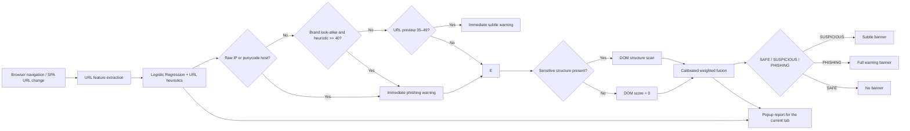

# PhishGuard: Automatic Local Phishing Scanner (v1.2.0)

A privacy-first, client-side Chrome / Edge extension that scans HTTP and HTTPS pages automatically. It evaluates URL features first, then checks page structure while the page continues to load.

---

## Key Highlights

- **Private & Local**: No remote API calls or telemetry. The DOM layer reads form destinations and page structure only; it never reads field values.
- **Automatic scanning**: Main-frame navigations and single-page URL changes are scanned without opening the extension popup or copying a URL.
- **Three detection layers**: URL Logistic Regression, explainable URL heuristics, and structural DOM checks run locally.
- **Risk-adaptive flow**: A raw IP or punycode host triggers an immediate phishing warning. A brand look-alike host does so when URL heuristics reach 40. URL-stage scores from 35–49 get an immediate subtle warning; DOM analysis can upgrade it to phishing, and a warning never downgrades during that navigation.
- **Explainable Decisions**: Every flagged risk includes auditable evidence cards and itemized point contributions that can be exported with one click.
- **Graceful Fallback**: If the ML model is unavailable or fails to initialize, the extension automatically falls back to URL heuristic and DOM fusion without breaking the user experience.

---

## Architecture & How It Works



### 1. Machine Learning Layer (`ml/inference.js`)
- **Model**: `StandardScaler` + `LogisticRegression` serialized directly to JSON (`ml/model.json`).
- **Dataset reference**: PhiUSIIL Phishing URL Dataset. The CSV and the training notebook/script are not present in this checkout, so the shipped model cannot currently be reproduced or independently validated from this repository.
- The current weights include a targeted calibration adjustment: URL path separators and generic terms such as “account” no longer dominate predictions. This is not a retraining run; proper retraining and validation require the missing dataset and training code.
- **Client-Side Feature Vector (20 features)**:
  1. `url_length`
  2. `hostname_length`
  3. `path_length`
  4. `query_length`
  5. `subdomain_count`
  6. `digit_count`
  7. `digit_ratio`
  8. `special_char_count`
  9. `hyphen_count`
  10. `dot_count`
  11. `slash_count`
  12. `has_https`
  13. `has_ip_host`
  14. `has_punycode`
  15. `has_at_symbol`
  16. `has_encoded_char`
  17. `hostname_entropy`
  18. `suspicious_keyword_count`
  19. `suspicious_tld`
  20. `query_parameter_count`

### 2. Heuristic Rules Engine (`rules.js`)
Evaluates URL patterns and brand mimicry signals:

| Signal | Points | Why It Matters |
|---|---:|---|
| **Brand look-alike (typosquatting)** | 30 | Detects Levenshtein distance $\le 1$ to major brands (e.g., `paypa1`, `micros0ft`). |
| **Punycode / IDN (`xn--`)** | 25 | Detects homograph-style internationalized domain attacks. |
| **Mixed-script hostname** | 25 | Identifies Cyrillic/Greek character substitution inside Latin hostnames. |
| **Raw IP address host** | 20 | Public legitimate services almost never use raw IPv4/IPv6 for authentication. |
| **`@` symbol in URL** | 12 | Misleading authority prefix used to conceal destination hosts. |
| **Deep subdomain chain ($\ge 4$ levels)** | 6–10 | Obscures the actual registrable domain behind spoofed subdomains. |
| **Suspicious keyword cluster** | 4–10 | Flags sensitive terms (`login`, `verify`, `wallet`, `password`, `update`). |
| **Higher-risk TLD** | 8 | Known abuse-heavy TLDs (`.zip`, `.mov`, `.click`, `.top`, `.xyz`, etc.). |
| **High hostname entropy ($\ge 4.0$)** | 6 | Reveals algorithmically generated domains (DGA) in phishing campaigns. |
| **Excessive URL length / hyphens** | 5–6 | Supporting obfuscation indicators. |

### 3. DOM Analysis (`content.js`)
Every page receives a lightweight structure probe. Pages with a password field or a form are fully scanned; an extreme-confidence URL still gets an asynchronous DOM scan after its immediate warning. Checks include password-form destinations, insecure form actions, hidden password fields, and hidden frames containing forms. It does not inspect what a user typed or transmit page data.

### 4. Fusion Scoring & Risk Bands
With the model: `fused = 0.30 × ML + 0.30 × URL heuristics + 0.40 × DOM`. Without it: `fused = 0.50 × URL heuristics + 0.50 × DOM`. Scores are clamped to 0–100. A raw IP or punycode host, or a brand look-alike host with URL heuristic score at least 40, floors the score at 80 and locks PHISHING. DOM score at least 70, or findings `hidden_password_field`, `password_form_cross_origin`, or `password_form_http`, floor the score at 60. `hidden_iframe_with_form` contributes its score without the finding-based floor. At the URL stage, the preview is `0.30 × ML + 0.30 × URL heuristics` when the model is available and URL heuristics alone when it is unavailable; scores from 35–49 show a subtle warning while DOM analysis continues.

- **0 – 34**: **SAFE** (No banner)
- **35 – 49**: **SUSPICIOUS** (Subtle banner)
- **50 – 100**: **PHISHING** (Full warning banner)

The URL heuristic and DOM scores are count-based signals, not calibrated probabilities; the fusion weights still need validation against a labeled evaluation set. DOM inspection cannot see password forms rendered only after user interaction or after the 30-second observation window. The warning is dismissible and does not block navigation.

---

## Project Structure

```text
phishguard-heuristics-extension/
├── manifest.json         # Manifest V3 extension configuration and permissions
├── background.js         # Navigation listener and staged scoring coordinator
├── content.js            # Local DOM structure checks
├── popup.html            # Extension popup layout
├── popup.css             # Dark-mode styling, gauges, and layouts
├── popup.js              # UI controller, event handlers & clipboard exporter
├── rules.js              # Deterministic heuristic engine (standalone & exportable)
├── hybrid.js             # URL and three-layer fusion scoring
├── icons/                # Extension action icons
├── ml/
│   ├── inference.js      # Pure JS feature extractor & logistic inference engine
│   └── model.json        # Scaler weights, means, scales & coefficients
├── data/
│   └── phiusiil/         # PhiUSIIL Phishing URL Dataset (CSV)
└── tests/
    └── rules.test.js     # Heuristic test suite (runs with Node.js)
```

---

## Installation & Setup

### Load into Chrome or Edge

1. Clone or download this repository.
2. Open `chrome://extensions` in Chrome (or `edge://extensions` in Edge).
3. Enable **Developer mode** (toggle in the top-right corner).
4. Click **Load unpacked** and select the `phishguard-heuristics-extension` directory.
5. Pin **PhishGuard** to your browser toolbar.

> [!NOTE]
> When you make changes to the code, click **Refresh** on the extension card in `chrome://extensions`. The extension requests access to HTTP and HTTPS pages so it can scan navigations automatically.

---

## Safe Testing & Demo Guide

Do **not** visit malicious websites directly. Navigate to safe sites to exercise automatic scanning. Test suspicious URL strings in the local heuristic rule code rather than opening them in the browser.

1. **Benign URL**:
   - `https://www.example.com/products?id=14`
   - *Result*: Usually SAFE; the final score depends on the URL and DOM signals
2. **Suspicious IP Endpoint**:
   - `http://192.168.1.55/verify-account`
   - *Result*: Test the string with `PhishGuardRules.scoreUrl(...)`; do not navigate to it.
3. **Severe Brand Impersonation**:
   - `https://paypa1-login-secure.xyz/verify`
   - *Result*: Test the string with `PhishGuardRules.scoreUrl(...)`; do not navigate to it.
4. **Export Audit Report**:
   - Click **Copy report** to copy the complete forensic summary to your clipboard.

---

## Running Automated Tests

Run the test suite using Node.js (no network connection or external npm dependencies needed):

```powershell
node tests/rules.test.js
```

---

## Privacy Policy & Permissions

PhishGuard processes browsing data locally:
- `webNavigation` & `tabs`: Read the URL of a navigated tab so it can be scored automatically and displayed in the popup report.
- `scripting` and HTTP/HTTPS host access: Run local DOM structure checks and show an in-page warning when the score reaches the threshold.
- `storage`: Keep the current tab's scan result in session storage for the popup report; results are removed when the tab closes.
- `clipboardWrite`: Used exclusively when the user clicks **Copy report**.
- **No Network Requests**: The extension makes no external HTTP requests; all computation is strictly local. It does not read or send form field values.
